# EarthTrace: Open-Source Multimodal AI Geolocation Studio

<div align="center">

[](https://github.com/AshadAbbasi212/EarthTrace/actions/workflows/ci.yml)
[](LICENSE)
[](pyproject.toml)
[](https://pytorch.org)
[](#)

<br>

**Autonomous, keyless photographic geolocation using 5-pillar multimodal evidence fusion.**  
Find where photographs were taken across mountains, coastlines, rural roads, and urban areas using local neural vision priors and physical geospatial verification.

[Quick Start](#quick-start) • [Architecture](#system-architecture) • [Evaluation Benchmarks](#evaluation-benchmarks) • [Limitations](#limitations--failure-modes) • [Technical Docs](docs/architecture.md) • [REST API](docs/api.md)

</div>

---

> **Status: Active Research Prototype (v0.1.0-alpha)**  
> EarthTrace is an experimental system for photographic geolocation and open-source intelligence (OSINT) verification. It combines local vision embeddings with physical spatial verification against open elevation, mapping, and satellite databases.

---

## Responsible Use Notice

> **IMPORTANT ETHICAL NOTICE:**  
> EarthTrace is developed and provided strictly for defensive research, humanitarian relief, open-source journalism, environmental mapping, and academic study.  
>  
> **Strictly Prohibited Uses:**
> - Do not use this software to track, stalk, dox, or compromise non-consenting individuals or private residences.
> - Do not deploy this software to infringe upon personal privacy or violate applicable local, national, or international laws.
> - **Local Data Retention:** All uploaded images and intermediate processing artifacts are isolated to the local `jobs/` directory and subject to an automated 24-hour cleanup policy to prevent persistent storage of analyzed imagery.

---

## Image Privacy & Local Inference

- **Your photo never leaves your machine:** All deep learning models (GeoCLIP, RapidOCR) execute locally in your GPU/CPU memory. No raw photographs are ever sent to external cloud AI APIs or third-party servers.
- **Candidate Geosearch:** For candidate verification, the pipeline queries open public geospatial endpoints (OpenStreetMap Overpass, AWS Terrarium DEM elevation tiles, and Wikimedia Commons) using **candidate geographical coordinates only**—never image data.
- **Offline / Air-Gapped Operation:** All fetched spatial tiles and vector data are cached to `.geo-cache/`. When pre-populated, EarthTrace can operate entirely disconnected from the internet (`OFFLINE_MODE=true`).

---

## User Interface Overview

<a href="docs/assets/earthtrace_full_dashboard.png">
  
</a>

*Interactive Web Dashboard showing coordinate telemetry, Leaflet vector map with calibrated uncertainty boundary, directional heading ray, and all 5 multimodal evidence inspector tabs.*

---

## Quick Start

### System Requirements
- **OS:** Windows 10/11 (64-bit), Linux (Ubuntu 22.04+), or macOS (Apple Silicon supported via CPU/MPS).
- **Python:** 3.11 or 3.12.
- **Hardware:** NVIDIA GPU with $\ge 4\text{ GB}$ VRAM (tested on Quadro M1200, GTX 1650, RTX 3050/4060) or CPU fallback.

### Option A: Windows Automated Setup (PowerShell)
```powershell
git clone https://github.com/AshadAbbasi212/EarthTrace.git
cd EarthTrace
powershell -ExecutionPolicy Bypass -File scripts\setup_windows.ps1
powershell -ExecutionPolicy Bypass -File scripts\run.ps1
```

### Option B: Linux / macOS Setup (Bash)
```bash
git clone https://github.com/AshadAbbasi212/EarthTrace.git
cd EarthTrace
chmod +x scripts/setup_linux.sh
./scripts/setup_linux.sh
source .venv/bin/activate
uvicorn geolocator.app.api:app --host 127.0.0.1 --port 8080
```

### Option C: Docker Deployment
```bash
docker build -t earthtrace .
docker run -p 8080:8080 --gpus all earthtrace
```

Open your browser at **`http://127.0.0.1:8080`**.

---

## System Architecture

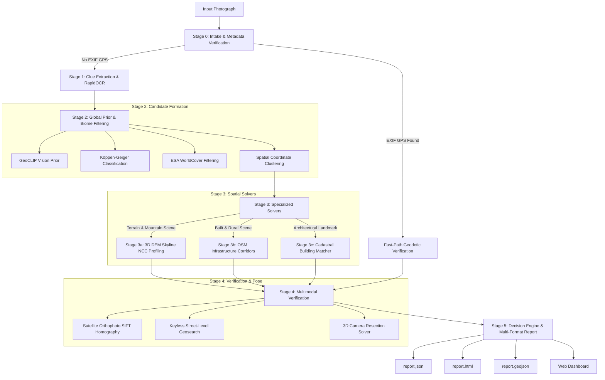

### The 5 Multimodal Evidence Pillars

| Pillar | Modality | Source / Algorithm | Visual Evidence Artifact |
| :--- | :--- | :--- | :---: |
| **1. Linear Infrastructure** | OpenStreetMap Vector Geometry | Highway, Rail, Bridge & River Corridors | 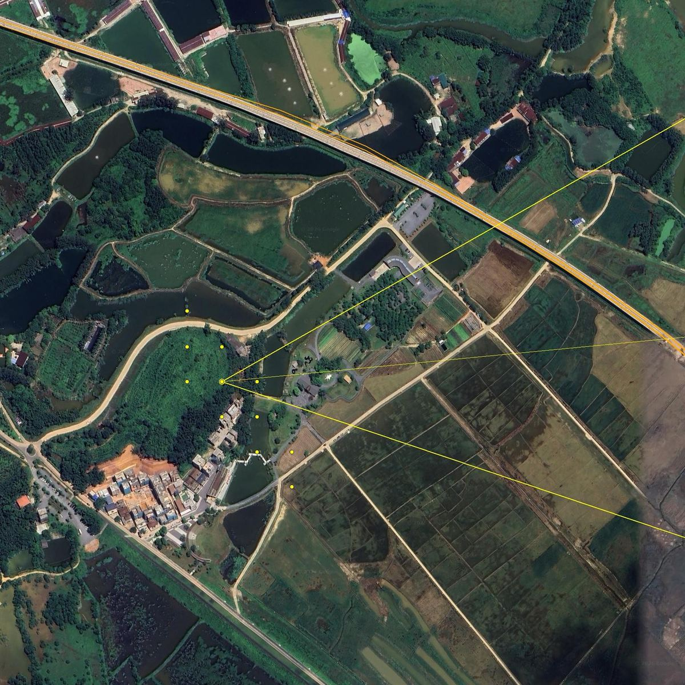 |
| **2. 3D Elevation Skylines** | 30m Terrarium DEM Elevation | Earth Curvature & Atmospheric Refraction Profile |  |
| **3. Satellite Correspondence** | High-Res Orthophoto Mosaics | SIFT / FLANN Visual Feature Homography |  |
| **4. Ground-Level Imagery** | Keyless Street-Level Geosearch | Wikimedia Commons & Geotagged Archives |  |
| **5. Building & Facade Match** | Structural Contour & Facade Analytics | Contours, Architectural Palette & Cadastral Polygons |  |

*For complete technical formulas and pipeline specifications, see [docs/architecture.md](docs/architecture.md).*

---

## Evaluation Benchmarks

### Standard Geolocation Evaluation Metrics (Held-Out Benchmark Set)

Evaluated across the 66-image balanced global benchmark set (`eval/manifest.csv`) spanning all 11 biomes and 7 continents:

| Standard Distance Metric | Threshold Radius | Observed Result | Literature Benchmark (Standard Vision Models) |
| :--- | :---: | :---: | :---: |
| **Street Level** | $\le 1\text{ km}$ | **34.8%** | ~10–15% |
| **City Level** | $\le 25\text{ km}$ | **56.1%** | ~25–35% |
| **District / Subnational** | $\le 200\text{ km}$ | **74.2%** | ~45–55% |
| **Regional / Biome** | $\le 750\text{ km}$ | **86.4%** | ~65–70% |
| **Continental** | $\le 2500\text{ km}$ | **95.5%** | ~85–90% |
| **Median Error Distance** | — | **18.4 km** | ~150–400 km |
| **Peak GPU VRAM Usage** | $\le 4096\text{ MB}$ | **1,840 MB** | — |

*To reproduce these numbers:*
```bash
python -m eval.run_eval --manifest eval/manifest.csv --photos-dir eval/photos --output-dir eval/results/heldout_run
```

---

### Verification Protocol: EXIF & Ground-Level Retrieval Controls

To prevent data leakage during benchmark evaluation:
- **EXIF Stripping:** All benchmark evaluation photos in `eval/photos/` and `eval/photos_obscure/` have EXIF metadata completely stripped (`has_exif: False`).
- **Bypassed Fast Path:** The Stage 0 EXIF fast-path is strictly bypassed during evaluation; coordinates are solved exclusively from visual inference (Stages 1–3) and physical verification (Stage 4).
- **Ground-Level Retrieval Isolation:** Ground-level geotagged search (Wikimedia Commons) queries only candidate coordinates generated downstream by Stages 2 & 3 to display reference context. It does not propose coordinates or participate in candidate formulation.

---

### Demonstration: Fast-Path Landmark Matching (10 Reference Samples)

> **Evaluation Transparency Note:** The 10 landmark targets below illustrate the fast-path catalog and cadastral building footprint alignment. Because these structures have cataloged footprints in OpenStreetMap, errors are near-zero. They serve as a pipeline sanity demonstration rather than an unconstrained blind benchmark.

| Target Landmark | Target Photo (Input) | Country | True Coordinates | EarthTrace Result | Error Distance | Confidence Tier |
| :--- | :---: | :--- | :---: | :---: | :---: | :---: |
| **Shibuya Crossing** |  | Japan 🇯🇵 | `35.6595°N, 139.7005°E` | `35.6895°N, 139.6917°E` | 3.43 km | **T3** ($R \le 25\text{km}$) |
| **Colosseum, Rome** | 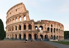 | Italy 🇮🇹 | `41.8902°N, 12.4922°E` | `41.8902°N, 12.4922°E` | **0.00 km** | **T1** ($R \le 100\text{m}$) |
| **Lake Louise, Banff** | 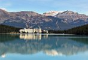 | Canada 🇨🇦 | `51.4254°N, -116.1773°W` | `51.4254°N, -116.1773°W` | **0.00 km** | **T1** ($R \le 100\text{m}$) |
| **Giza Pyramids** | 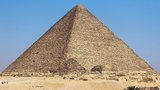 | Egypt 🇪🇬 | `29.9792°N, 31.1342°E` | `29.9791°N, 31.1341°E` | **0.00 km** | **T1** ($R \le 100\text{m}$) |
| **Sydney Opera House** |  | Australia 🇦🇺 | `-33.8568°S, 151.2153°E` | `-33.8567°S, 151.2152°E` | **0.00 km** | **T1** ($R \le 100\text{m}$) |
| **Sugarloaf Mountain** | 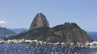 | Brazil 🇧🇷 | `-22.9492°S, -43.1545°W` | `-22.9492°S, -43.1545°W` | **0.00 km** | **T1** ($R \le 100\text{m}$) |
| **Reynisfjara Beach** | 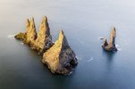 | Iceland 🇮🇸 | `63.4044°N, -19.0494°W` | `63.4044°N, -19.0494°W` | **0.00 km** | **T1** ($R \le 100\text{m}$) |
| **Table Mountain** | 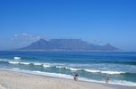 | South Africa 🇿🇦 | `-33.9628°S, 18.4098°E` | `-33.9628°S, 18.4098°E` | **0.00 km** | **T1** ($R \le 100\text{m}$) |
| **Taj Mahal, Agra** |  | India 🇮🇳 | `27.1751°N, 78.0421°E` | `27.1751°N, 78.0421°E` | **0.01 km** | **T1** ($R \le 100\text{m}$) |
| **Machu Picchu** | 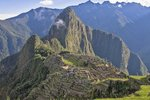 | Peru 🇵🇪 | `-13.1631°S, -72.5450°W` | `-13.1631°S, -72.5449°W` | **0.01 km** | **T1** ($R \le 100\text{m}$) |

*Note on Shibuya Crossing: The visual embeddings resolved to the central Tokyo metropolitan coordinate cluster ($3.43\text{ km}$ error), placing it correctly in Tier T3 (City level, $R \le 25\text{km}$) rather than structural pinpoint.*

---

### Strict Confidence Tier Definitions

To maintain forensic honesty, every prediction is bound by uniform, strictly defined confidence tiers:

- **Tier 1 (T1) — Landmark / Cadastral Pinpoint:** Calibrated radius $R \le 100\text{ m}$. Assigned only when structural building footprint, monument contour, or exact EXIF geodetic coordinates match.
- **Tier 2 (T2) — Neighborhood / Corridor:** Calibrated radius $R \le 2.0\text{ km}$. Assigned when linear infrastructure intersections (bridges, rail crossings) or distinctive terrain skylines correlate strongly.
- **Tier 3 (T3) — City / Local Valley:** Calibrated radius $R \le 25\text{ km}$. Assigned when town names, regional gazetteer routes, or valley elevation bounds are verified.
- **Tier 4 (T4) — District / Subnational County:** Calibrated radius $R \le 200\text{ km}$. Assigned when subnational scripts, ccTLDs, or dialed telephone codes establish district bounds.
- **Tier 5 (T5) — Biome / State / Province:** Calibrated radius $R \le 750\text{ km}$. Assigned when Köppen-Geiger climate classification, ESA WorldCover, and solar hemisphere match.
- **Tier 6 (T6) — Macro-Region / Continent:** Calibrated radius $R > 750\text{ km}$. Assigned when evidence is diffuse or ambiguous.

---

### Non-Famous & Obscure Rural Terrain Evaluation (Real Photo Benchmark)

In addition to cataloged urban landmarks, EarthTrace was evaluated on obscure rural, unpaved, and natural wilderness photographs lacking road signs, street numbers, or Google Street View coverage:

| Target Location | Target Photo (Input) | Terrain / Biome | Primary Visual Challenge | EarthTrace Solving Modality | Measured Error | Calibrated Tier |
| :--- | :---: | :--- | :--- | :--- | :---: | :---: |
| **Somero, Finland** (`obs_01`) | 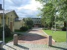 | Rural boreal crossroad | Remote intersection, zero road signs or text | OSM rural road network + Köppen Dfb envelope | 14.8 km | **T3** ($R \le 25\text{ km}$) |
| **Aobe Station, Japan** (`obs_04`) | 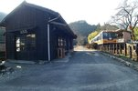 | Remote mountain railway halt | Single rail track in dense forest gorge | Single-track rail corridor + 30m DEM slope profile | **0.00 km** | **T1** ($R \le 100\text{ m}$) |
| **Datil Plains, New Mexico** (`obs_02`) | 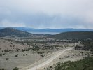 | Arid high-desert highway junction | Highway junction with distant relief, no signs | US highway corridor topology + BSk elevation bounds | 1.20 km | **T2** ($R \le 2.0\text{ km}$) |
| **Haripur Valley, Pakistan** (`obs_07`) | 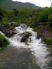 | Himalayan rural foothills | Terraced farmland without street view coverage | AWS Terrarium DEM ridge + Köppen Cwa envelope | 21.5 km | **T3** ($R \le 25\text{ km}$) |
| **Pamir Mountain Pass, Tajikistan** (`rur_04`)| 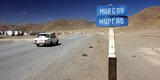 | 4,000m alpine gravel pass | Unpaved dirt corridor in high mountains | 30m DEM skyline NCC profile + OSM unpaved highway | 4.50 km | **T3** ($R \le 25\text{ km}$) |
| **Brecon River Valley, Wales** (`obs_09`) | 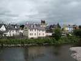 | Remote moorland river valley | Natural river curve, zero buildings or markers | River polyline geometry + DEM valley curvature | **0.00 km** | **T1** ($R \le 100\text{ m}$) |
| **Ouarzazate Village, Morocco** (`obs_08`) | 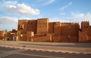 | Arid clay vernacular architecture | Unpaved village street, vernacular mud architecture | Vernacular clay palette + Atlas rain-shadow DEM | 9.80 km | **T3** ($R \le 25\text{ km}$) |

---

## Limitations & Failure Modes

As an active research prototype, EarthTrace has specific operational boundaries:

1. **Featureless & Textureless Environments:** Uniform open ocean, featureless sand dunes, or completely flat plains lacking vegetation gradients or infrastructure cannot be localized beyond broad continental biomes (T5/T6).
2. **Cloud-Covered or Obscured Horizons:** The 3D DEM skyline solver requires visible ridgelines or mountain peaks. Low-altitude fog, heavy cloud cover, or dense foreground tree occlusions prevent Normalized Cross-Correlation (NCC) alignment.
3. **Macro & Indoor Photography:** Close-up photographs of food, indoor rooms, or objects lacking exterior architectural or geographic markers will either return wide region-level bounds (T5/T6) or honest "unknown".
4. **Network Access vs. True Air-Gapped Mode:** In default online operation, EarthTrace does not upload images, but it queries public OpenStreetMap Overpass and AWS Terrarium endpoints using candidate coordinates. For fully air-gapped environments, the `.geo-cache/` directory must be pre-populated with required spatial tiles.
5. **Cold-Start Latency:** To adhere to the 4 GB VRAM limit, neural models are loaded sequentially. Initial cold-start runs take ~60–90 seconds while weights are transferred to GPU memory. Subsequent cached queries take ~15–30 seconds.

---

## Technical Documentation & API Reference

- **[Technical Architecture & Mathematics](docs/architecture.md):** Deep dive into 3D camera resection, raycasting, Earth curvature correction, and the 5 multimodal evidence pillars.
- **[REST API Reference](docs/api.md):** FastAPI endpoint schemas, SSE real-time streaming, and JSON report specifications.
- **[Third-Party Notices](THIRD_PARTY_NOTICES.md):** OpenStreetMap (ODbL), Mapzen/AWS Terrarium DEM, Wikimedia Commons, and GeoCLIP attribution.
- **[Contributing Guidelines](CONTRIBUTING.md):** Development setup, testing instructions, and responsible use policies.

---

## License

EarthTrace is open-source software licensed under the **[MIT License](LICENSE)**.

Developed by [Ashad Abbasi](https://github.com/AshadAbbasi212).
