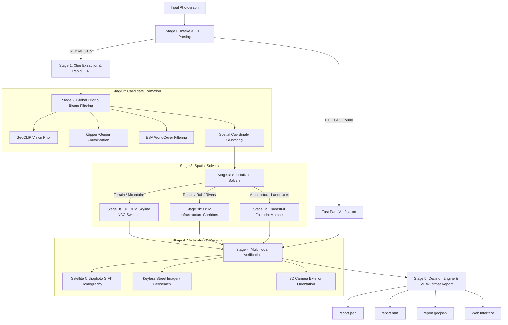

# EarthTrace Technical Architecture & Multimodal Pipeline

This document details the internal architecture, mathematical formulations, and multimodal evidence solvers that power EarthTrace.

---

## Pipeline Execution Stages

---

## The 5 Multimodal Evidence Pillars

### 1. Linear Infrastructure Corridors (OpenStreetMap)
Extracts linear vector ways (highways, railways, bridges, river corridors, and canals) within the candidate search radius using Overpass. Computes polyline heading signatures and junction topologies.

### 2. 3D Elevation Skylines (30m Terrarium DEM)
Fetches ~30m Digital Elevation Model tiles. Simulates physical raycasts from candidate observer positions, factoring in:
- **True Earth Curvature:** $R = 6371\text{ km}$
- **Atmospheric Refraction:** Terrestrial coefficient $k = 0.13$
- **Normalized Cross-Correlation (NCC):** Sweeps horizon silhouettes across $360^\circ$ azimuth to locate peak correlation with photographic skylines.

### 3. Satellite Orthophoto Homography
Fetches keyless overhead imagery for candidate coordinates. Computes SIFT keypoint descriptors and FLANN matching to estimate homography matrix $H$ and verify surface features.

### 4. Ground-Level Geotagged Imagery
Queries keyless geotagged image repositories (Wikimedia Commons) within candidate bounds. When remote or wilderness locations have no street imagery, the system explicitly reports `"status": "not available"`.

### 5. Cadastral Building Facades & Footprints
Detects architectural contours and building facades using adaptive contour extraction. Matches polygonal aspect ratios, area footprints, and orientation angles directly against OpenStreetMap building polygon geometries.

---

## Memory & Resource Management

EarthTrace enforces a strict **Single-Resident ModelManager** architecture:
- Deep learning models (GeoCLIP, RapidOCR) are loaded sequentially into GPU memory.
- Inference is performed in thread-safe batches.
- PyTorch CUDA memory caches are purged (`torch.cuda.empty_cache()`) immediately after inference.
- Guaranteed to operate within a **4 GB VRAM** envelope on consumer GPUs.
